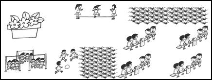

# Mathematics (Grade 3)

**ID**: 202bd214
**难度**: hard
**题型**: short_answer

## 题目
看图回答

（1）一班有9组同学在玩跳皮筋，玩跳皮筋的一共有多少人？
（2）1班共有56名同学，除了玩跷跷板的，玩其他游戏的有多少人？
（3）你还能提出什么问题？

## 解答

**答案**: 27人, 40人, 9(人)

1. Step1:观察图片可知玩跳皮筋每组有3人，一班有9组同学玩跳皮筋，根据每份数×份数=总数，可得玩跳皮筋的人数为3×9 = 27人
2. Step2:观察图片可知玩跷跷板的每组有4人，有4组，先根据每份数×份数=总数，得出玩跷跷板的人数为4×4 = 16人，已知1班共有56名同学，再根据总人数 - 玩跷跷板的人数 = 玩其他游戏的人数，即56 - 16 = 40人
3. Step3:提出问题“玩秋千的有多少人？”，观察图片可知玩秋千的每组有3人，有3组，根据每份数×份数=总数，可得玩秋千的人数为3×3 = 9人

## 知识点

**知识点**:
  - 小学数学;数与代数;应用题;常见的数学问题;图文问题

---
