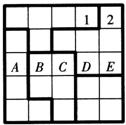

# Mathematics (Grade 3)

**ID**: 387dd933
**难度**: hard
**题型**: short_answer

## 题目
如图，5×5的方格表被分成了五块，请你在每格中填入1、2、3、4、5中的一个（其中两个格子已经分别填入1和2），使得每行、每列、每条对角线的五个数各不相同，且每块上所填数的和都相等，请问：$\bar{ABCDE}$是多少？

## 解答

**答案**: 14523

1. Step1:计算每行、每列、每条对角线以及每块的和。因为是5×5的方格表，填入1 - 5，所以每行、每列、每条对角线的和为(1 + 2 + 3 + 4 + 5)=15，总的和为75，分成五块，每块的和也为15。
2. Step2:确定B上面格子的数字。由于每块和为15，结合已有的数字，可知B上面格子的数字为2。
3. Step3:分析右下角4个格子的数字组合。右下角4个格和是15，其组合有15=5+4+3+3=5+5+4+1=5+5+3+2=5+4+4+2，根据对角线5个数不一样的条件，排除不符合的组合，得出右下角那4个是5541。
4. Step4:确定C的值。因为第4列第一个格子是1，所以D下面那个格子是4，右下角是1，假设C=3会出现矛盾，所以C=5。
5. Step5:确定E和D的值。左上角是3，即第2列最后那个格子是3，所以D上面那个格子是3，进而得出E=3，D=2。
6. Step6:确定A和B的值。B下面格子是1，左下角是4，所以A=1，B=4。
7. Step7:得出五位数$\bar{ABCDE}$为14523。

## 知识点

**知识点**:
  - 数字和问题．

---
