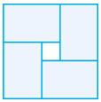

# Mathematics (Grade 3)

**ID**: 4e35abdd
**难度**: hard
**题型**: short_answer

## 题目
小刚用4个完全一样的长方形纸片拼成了一个边长是30厘米的正方形（如图）．中间形成的空白部分也是一个正方形，它的边长是6厘米．
（1）你知道小刚用的长方形纸片的周长是多少吗？
（2）每个长方形的长与宽各是多少厘米？

## 解答

**答案**: 60, 18, 12

1. Step1:根据图可知大正方形边长等于长方形的长与宽的和，已知大正方形边长为30厘米，所以长方形长加宽为30厘米
2. Step2:因为长方形周长等于（长 + 宽）×2，长加宽为30厘米，所以长方形纸片周长为30×2 = 60厘米
3. Step3:已知小正方形边长为6厘米，大正方形边长加上小正方形边长是2个长方形的长，即(30 + 6)÷2 = 18厘米，得到长方形的长
4. Step4:大正方形边长减去小正方形边长是2个长方形的宽，即(30 - 6)÷2 = 12厘米，得到长方形的宽

## 知识点

**知识点**:
  - 长方形的周长

---
