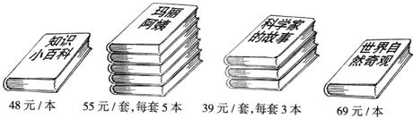

# Mathematics (Grade 3)

**ID**: 64f51759
**难度**: hard
**题型**: short_answer

## 题目
解决问题．

(1)买1册《玛丽阿姨》和1本《知识小百科》，一共需要多少元？
(2)买3本《世界自然奇观》和1本《知识小百科》，260元够吗？
(3)你还能提出什么数学问题？并解答出来．

## 解答

**答案**: 59, 255, 68

1. Step1:计算买1册《玛丽阿姨》和1本《知识小百科》的总花费，先算出每本《玛丽阿姨》的单价为55÷5 = 11元，再加上《知识小百科》的单价48元，即11 + 48 = 59元
2. Step2:计算买3本《世界自然奇观》和1本《知识小百科》的总花费，先算出3本《世界自然奇观》的花费为69×3 = 207元，再加上《知识小百科》的单价48元，即207 + 48 = 255元
3. Step3:提出问题“买一套《玛丽阿姨》和一本《科学家的故事》需要多少元”并解答，先算出每本《科学家的故事》的单价为39÷3 = 13元，再加上每套《玛丽阿姨》的单价55元，即13 + 55 = 68元

## 知识点

**知识点**:
  - 整数、小数复合应用题;“提问题”、“填条件”应用题;图文应用题．

---
