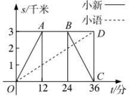

# Mathematics (Grade 3)

**ID**: 6c8a805f
**难度**: hard
**题型**: short_answer

## 题目
小新和小语沿同一条路同时从学校出发到西安图书馆查阅资料，学校到图书馆的路程是3千米，小新骑自行车，小语步行，当小新沿原路回到学校时，小语刚好到达图书馆。图中折线O-A-B-C和线段OD分别表示两人离学校的路程s（千米）与所经过的时间t（分）之间的关系，请根据回答下列问题：

（1）小新在图书馆查阅资料的时间为（）分钟，小新返回学校的速度为（）千米/分。
（2）当小新与小语迎面相遇时，他们离学校的路程是多少千米？

## 解答

**答案**: 12, $\\frac{1}{4}$, $\\frac{9}{4}$

1. Step1:从图中可知小新到达图书馆的时间是12分钟，离开图书馆的时间是24分钟，所以小新在图书馆查阅资料的时间为24 - 12 = 12分钟
2. Step2:小新返回的路程是3千米，返回所用时间是36 - 24 = 12分钟，根据速度=路程÷时间，可得小新返回学校的速度为3÷(36 - 24)=3÷12 = $\frac{1}{4}$千米/分
3. Step3:由图可知小语从学校到图书馆用时36分钟，学校到图书馆路程是3千米，根据速度=路程÷时间，可得小语的速度为3÷36 = $\frac{3}{36}$千米/分
4. Step4:小新返回时与小语是相向而行，此时两人相距3千米，两人的速度和为$\frac{1}{4}+\frac{3}{36}$，根据相遇时间=路程÷速度和，可得相遇时间为1÷($\frac{1}{4}+\frac{3}{36}$)=1÷$\frac{1}{3}$ = 3分钟
5. Step5:小语总共用时24 + 3 = 27分钟，根据路程=速度×时间，可得小语走的路程为27×$\frac{3}{36}$ = $\frac{9}{4}$千米，即小新与小语迎面相遇时离学校的路程是$\frac{9}{4}$千米

## 知识点

**知识点**:
  - 简单的行程问题

---
