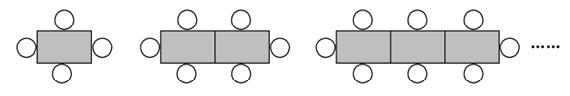

# Mathematics (Grade 3)

**ID**: 833930cf
**难度**: hard
**题型**: short_answer

## 题目
为了庆祝元旦，同学们共进午餐。 

 （1）1张餐桌可坐4人，2张餐桌拼在一起可坐6人，3张餐桌拼在一起可坐8人，那么4张餐桌拼在一起可坐多少人？5张呢？
 （2按这样拼下去，n张餐桌拼在一起可坐多少人？
 （3）当n＝20时，可坐多少人？

## 解答

**答案**: 10, 12, 2n＋2, 42

1. Step1:分析已知条件，1张餐桌坐4人，2张餐桌拼一起坐6人，3张餐桌拼一起坐8人，发现多一张餐桌就增加2人
2. Step2:计算4张餐桌可坐人数，3张餐桌坐8人，4张餐桌则为8 + 2 = 10人
3. Step3:计算5张餐桌可坐人数，4张餐桌坐10人，5张餐桌则为10 + 2 = 12人
4. Step4:寻找张数n与可坐人数的关系，通过列举1张餐桌4 = 2×1＋2，2张餐桌6 = 2×2＋2，3张餐桌8 = 2×3＋2等，得出n张餐桌可坐人数为2n＋2
5. Step5:当n＝20时，将其代入2n＋2，计算2×20＋2 = 42人

## 知识点

**知识点**:
  - 

---
