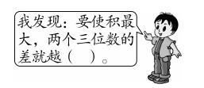

# Mathematics (Grade 3)

**ID**: 865a0393
**难度**: hard
**题型**: short_answer

## 题目
用1，2，3，4，5，6这6个数字任意组成两个三位数，要想使它们的积最大，组成的数各是多少？再用计算器计算一下它们的积最大是多少。

我发现：要使积最大，两个三位数的差就越（）。

## 解答

**答案**: 631, 542, 342002, 小

1. Step1:确定两个三位数的百位数字，因为要使乘积最大，所以百位应是6和5
2. Step2:考虑十位数字，在剩下的3、4中，通过计算63和54相差9，64和53相差11，可知选择63和54能使两个数更接近
3. Step3:考虑个位数字1和2，经过分析得出组成631和542时两个三位数相差最小
4. Step4:计算631×542的积为342002
5. Step5:总结发现要使积最大，两个三位数的差就越小

## 知识点

**知识点**:
  - 多位数的乘法;整数的认识

---
