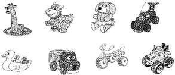

# Mathematics (Grade 3)

**ID**: a20871ff
**难度**: hard
**题型**: short_answer

## 题目
解决问题．

春天幼儿园有8种玩具，每种4个．
（1）一共有玩具多少个？
（2）又买来35个玩具，现在一共有多少个玩具？
（3）每个小朋友发1个玩具，如果有60个小朋友，还剩几个玩具？
（4）每个小朋友发1个玩具，如果有70个小朋友，还差几个玩具？

## 解答

**答案**: 32, 67, 7, 3

1. Step1:根据已知条件，春天幼儿园有8种玩具，每种4个，用乘法计算玩具总数，即8×4 = 32个，得出第一问答案
2. Step2:已知原来有32个玩具，又买来35个，用加法计算现在玩具总数，即32 + 35 = 67个，得出第二问答案
3. Step3:已知有67个玩具，60个小朋友，每个小朋友发1个玩具，用玩具总数减去发给小朋友的玩具数，即67 - 60×1 = 7个，得出第三问答案
4. Step4:已知有67个玩具，70个小朋友，每个小朋友发1个玩具，用小朋友需要的玩具总数减去现有的玩具数，即70×1 - 67 = 3个，得出第四问答案

## 知识点

**知识点**:
  - 整数、小数复合应用题．

---
