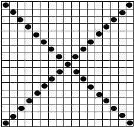

# Mathematics (Grade 3)

**ID**: a38f2165
**难度**: hard
**题型**: short_answer

## 题目
育红小学的学生进行举花方阵表演，小方阵中有33名学生举起红花组成图案，如图所示：
（1）请同学们算一算，没有举红花的学生有多少人？
（2）如果77人举起红花组成同样的图案，请同学们算一算，没有举红花的学生有多少人？

## 解答

**答案**: 256, 1444

1. Step1:计算小方阵中举红花时每边的人数，即(33 + 1)÷2 = 17人
2. Step2:计算小方阵的总人数，即17×17 = 289人
3. Step3:计算小方阵中没有举红花的人数，即289 - 33 = 256人
4. Step4:计算77人举红花时每边的人数，即(77 + 1)÷2 = 39人
5. Step5:计算77人举红花时方阵的总人数，即39×39 = 1521人
6. Step6:计算77人举红花时没有举红花的人数，即1521 - 77 = 1444人

## 知识点

**知识点**:
  - 方阵问题．

---
