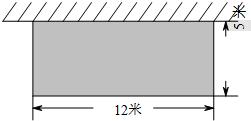

# Mathematics (Grade 3)

**ID**: a9500ec3
**难度**: hard
**题型**: short_answer

## 题目
如图，王大伯家有一块靠墙的长方形空地，他准备用篱笆围出一个尽可能大的正方形做鸡舍，剩下的做菜地．围鸡舍的篱笆至少长多少米？如果把菜地也用篱笆围起来，至少还需要篱笆多少米？

## 解答

**答案**: 15, 12

1. Step1:因为要围出尽可能大的正方形，所以正方形边长为5米，又因一条边靠墙，所以围鸡舍篱笆长度为3×5 = 15米
2. Step2:菜地的长为12 - 5 = 7米，宽为5米，且和鸡舍有一条公共边，所以围菜地至少还需篱笆7 + 5 = 12米

## 知识点

**知识点**:
  - 长方形的周长

---
