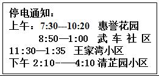

# Mathematics (Grade 3)

**ID**: bf2d38aa
**难度**: hard
**题型**: short_answer

## 题目
（1）上午10：00时，哪些地方停电？
（2）小明中午12：00回家发现停电了，他家住哪个小区？还要多长时间才能来电？

## 解答

**答案**: 惠誉花园, 武车社区, 1小时, 王家湾小区, 1小时35分钟

1. Step1:查看停电通知，找出上午10：00所在的停电时间段为7：30 - 10：20，对应的停电小区是惠誉花园
2. Step2:查看停电通知，找出中午12：00所在的停电时间段，分别为8：50 - 1：00和11：30 - 1：35
3. Step3:8：50 - 1：00对应的停电小区是武车社区，计算武车社区来电时间与12：00的时间差，1时 + 12时 - 12时 = 1小时
4. Step4:11：30 - 1：35对应的停电小区是王家湾小区，计算王家湾小区来电时间与12：00的时间差，1时35分 + 12时 - 12时 = 1小时35分钟

## 知识点

**知识点**:
  - 日期和时间的推算

---
