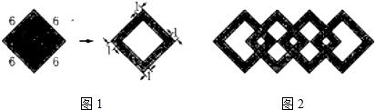

# Mathematics (Grade 3)

**ID**: cfd09e58
**难度**: hard
**题型**: short_answer

## 题目
如图1，从边长是6厘米的正方形纸片的正中间挖去一个正方形，得到一个宽为1厘米的方框，将四个这样的方框如图6所示依次垂直交叉放在桌面上，求桌面被这些方框盖住的面积（图2中阴影部分的面积）．

## 解答

**答案**: 74

1. Step1:计算外面大正方形的面积，根据正方形面积公式，边长为6厘米，面积为6×6 = 36平方厘米
2. Step2:计算里面小正方形的边长，为6 - 1×2 = 4厘米
3. Step3:计算里面小正方形的面积，根据正方形面积公式，面积为4×4 = 16平方厘米
4. Step4:计算一个方框的面积，用外面大正方形面积减去里面小正方形面积，即36 - 16 = 20平方厘米
5. Step5:计算4个方框的面积和，为20×4 = 80平方厘米
6. Step6:确定重叠部分，4个方框有6处重叠，重叠部分是边长为1厘米的正方形
7. Step7:计算6个重叠小正方形的面积，为1×1×6 = 6平方厘米
8. Step8:计算桌面被方框盖住的面积，用4个方框的面积和减去6个小正方形的面积，即80 - 6 = 74平方厘米

## 知识点

**知识点**:
  - 重叠问题

---
