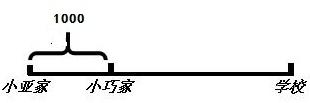

# Mathematics (Grade 3)

**ID**: d0a333aa
**难度**: hard
**题型**: short_answer

## 题目
如图：小巧家和小亚家的距离1000米，小巧和小亚两人同时从家里出发，相向而行．小巧平均每分钟行55米，小亚平均每分钟行60米，经过多少分钟后两人还相距80米？

## 解答

**答案**: 8, 9$\frac{9}{23}$

1. Step1:计算两人相遇前相距80米时两人行走的路程之和，即1000 - 80 = 920米
2. Step2:计算两人的速度之和，即55 + 60 = 115米/分钟
3. Step3:用相遇前两人行走的路程之和除以速度之和，得到相遇前相距80米时所用时间，即920÷115 = 8分钟
4. Step4:计算两人相遇后相距80米时两人行走的路程之和，即1000 + 80 = 1080米
5. Step5:用相遇后两人行走的路程之和除以速度之和，得到相遇后相距80米时所用时间，即1080÷115 = 9$\frac{9}{23}$分钟

## 知识点

**知识点**:
  - 简单的行程问题

---
