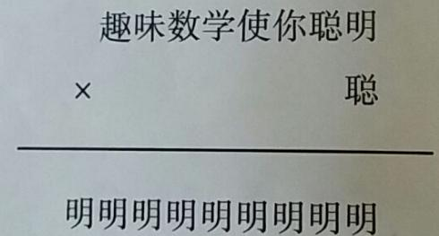

# Mathematics (Grade 3)

**ID**: d955c798
**难度**: hard
**题型**: short_answer

## 题目
请你把等式中汉字代表的数字破译出来．(不同汉字代表不同数字,相同汉字代表相同数字)

 趣味数学使你聪明×聪=明明明明明明明明明

## 解答

**答案**: 61728395, 9, 555555555

1. Step1:根据趣味数学使你聪明×聪=明明明明明明明明明，可知积是9位数，且首位是明，明×聪的尾数还是明，同时聪不能是1，因为积进位了。
2. Step2:列举不同数字相乘的尾数情况：2×3=6 2×4=8 2×5=0 2×6=2 2×7=4 2×8=6 2×9=8 3×4=2 3×5=5 3×6=8 3×7=1 3×8=4 3×9=7 4×5=0 4×6=4 4×7=8 4×8=2 4×9=6 5×6=0 5×7=5 5×8=0 5×9=5 6×7=2 6×8=8 6×9=3 7×8=6 7×9=3 8×9=2，找出尾数符合明×聪=明形式的组合：2×6=2 3×5=5 4×6=4 5×7=5 5×9=5。
3. Step3:对上述可能组合进行后两位验证，计算62×6=372  35×3=105  64×6=384 75×7=525  95×9=855，发现95×9符合要求，从而确定聪=9，明=5。
4. Step4:因为聪=9，明=5，所以得出61728395×9=555555555，进而得到趣味数学使你聪明为61728395，聪为9，明明明明明明明明明为555555555。

## 知识点

**知识点**:
  - --

---
