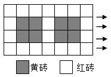

# Mathematics (Grade 3)

**ID**: eeccb397
**难度**: hard
**题型**: short_answer

## 题目
阳光小区要铺设一条通道，通道长82米，宽1.6米．现在用边长是0.4米的红、黄两种正方形地砖铺设．（下图是铺设的局部图示）
（1）铺设这条通道一共需多少块地砖？
（2）铺设这条通道一共需要多少块红地转？

## 解答

**答案**: 820, 548

1. Step1:计算通道总面积，通道长82米，宽1.6米，根据长方形面积公式S=长×宽，可得通道总面积为82×1.6 = 131.2平方米
2. Step2:计算每块地砖面积，地砖边长是0.4米，根据正方形面积公式S=边长×边长，可得每块地砖面积为0.4×0.4 = 0.16平方米
3. Step3:用通道总面积除以每块地砖面积，得到所需地砖总数，即131.2÷0.16 = 820块
4. Step4:计算通道沿长的方向可铺地砖列数，通道长82米，地砖边长0.4米，82÷0.4 = 205列
5. Step5:确定循环周期，每三列为一个循环周期，每个周期有8块红砖
6. Step6:计算循环周期数，205÷3 = 68余1
7. Step7:计算红砖数量，68个完整周期的红砖数为68×8，余下1列中有4块红砖，所以红砖总数为68×8 + 4 = 548块

## 知识点

**知识点**:
  - 图形的拼组．

---
