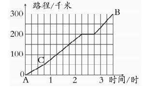

# Mathematics (Grade 3)

**ID**: f04b3470
**难度**: hard
**题型**: short_answer

## 题目
星期天小明和爸爸去旅游，他把汽车从A城到B城的行驶情况制成了下面图的统计图。

（1）汽车从A城行驶到高速公路收费站C处的速度大约是每小时多少千米？(得数保留整数)
（2）汽车在B城多少千米处休息了一段时间？休息了多少小时？
（3）从收费站C处到B城的这段高速公路上，汽车平均速度大约是每小时多少千米？

## 解答

**答案**: 67, 100, 0.5, 91

1. Step1:根据图像可知从A城到C处路程是50千米，时间是$rac{3}{4}$小时，根据速度=路程÷时间，可得速度为50÷$rac{3}{4}$，计算结果保留整数约为67千米/小时，此为第一问答案
2. Step2:从图像中找出平行于横轴的线段确定休息时间段，可知休息时行驶路程为200千米，A、B两城间路程为300千米，用300 - 200 = 100千米，得到汽车在距离B城100千米处休息，此为第二问第一个答案
3. Step3:由图像可知汽车休息时间从2小时到2.5小时，2.5 - 2 = 0.5小时，得到休息时间为0.5小时，此为第二问第二个答案
4. Step4:从C处到B城的路程为300 - 50 = 250千米，时间为$3rac{1}{2}$ - $rac{3}{4}$小时，根据速度=路程÷时间，可得速度为(300 - 50)÷($3rac{1}{2}$ - $rac{3}{4}$)，计算结果保留整数约为91千米/小时，此为第三问答案

## 知识点

**知识点**:
  - 从统计图表中获取信息;简单的行程问题

---
