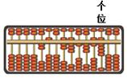

# Mathematics (Grade 3)

**ID**: 006b6893
**难度**: medium_easy
**题型**: fill_in_the_blank

## 题目
如图的算盘中的数写作_____．

## 解答

**答案**: 250781369

1. Step1:观察算盘，从右往左确定个位、十位、百位等数位
2. Step2:根据算盘上珠子的位置和计数规则，个位上有4个下珠表示4
3. Step3:十位上有1个上珠和2个下珠，表示70
4. Step4:百位上有3个下珠，表示300
5. Step5:千位上有1个上珠和3个下珠，表示8000
6. Step6:万位上有1个下珠，表示10000
7. Step7:十万位上有7个下珠，表示700000
8. Step8:百万位上有0个珠子，表示0
9. Step9:千万位上有5个下珠，表示50000000
10. Step10:亿位上有2个下珠，表示200000000
11. Step11:将各个数位上表示的数相加，得到250781369

## 知识点

**知识点**:
  - 小学数学;数与代数;数的运算;算盘的认识与使用

---
