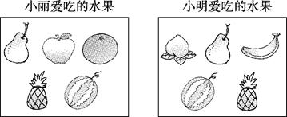

# Mathematics (Grade 3)

**ID**: 0250f307
**难度**: medium_easy
**题型**: fill_in_the_blank

## 题目

小丽爱吃的水果有（_____）种，小明爱吃的水果有（_____）种，他们爱吃的水果共有（_____）种。

## 解答

**答案**: 5, 5, 7

1. Step1:数小丽爱吃水果的种类，可得小丽爱吃的水果有5种
2. Step2:数小明爱吃水果的种类，可得小明爱吃的水果有5种
3. Step3:找出小丽和小明爱吃水果中所有不重复的水果，数出共有7种

## 知识点

**知识点**:
  - 小学数学;数与代数;应用题;常见的数学问题;集合问题

---
