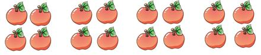

# Mathematics (Grade 3)

**ID**: 05154b25
**难度**: medium_easy
**题型**: fill_in_the_blank

## 题目
看图列式计算

加法算式:________  乘法算式:_________

## 解答

**答案**: 4+4+4+4=16, 4×4=16

1. Step1:观察图片可知，图中有4组苹果，每组有4个。
2. Step2:根据加法的意义，求几个相同加数的和的简便运算用加法，这里是4个4相加，所以加法算式为4 + 4 + 4 + 4 = 16。
3. Step3:根据乘法的意义，求几个相同加数的和可以用乘法计算，相同的加数作一个因数，相同加数的个数作另一个因数，所以乘法算式为4×4 = 16。

## 知识点

**知识点**:
  - 小学数学;数与代数;应用题;常见的数学问题;图文问题

---
