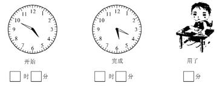

# Mathematics (Grade 3)

**ID**: 0b21197f
**难度**: medium_easy
**题型**: fill_in_the_blank

## 题目
下面是小强写作业的时间，看图填一填。

## 解答

**答案**: 4, 50, 5, 20, 30

1. Step1:观察开始时间的时钟，时针指向 4 和 5 之间，分针指向 10，所以开始时间是 4 时 50 分
2. Step2:观察完成时间的时钟，时针指向 5 和 6 之间，分针指向 4，所以完成时间是 5 时 20 分
3. Step3:计算所用时间，5 时 20 分 - 4 时 50 分 = 30 分
4. Step4:按照题目要求，将开始时间的时、分，完成时间的时、分，以及所用时间的分数依次填入对应的空，即 4、50、5、20、30

## 知识点

**知识点**:
  - 

---
