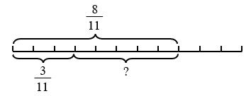

# Mathematics (Grade 3)

**ID**: 1076603e
**难度**: medium_easy
**题型**: fill_in_the_blank

## 题目
看图列式并计算。 

 $\frac{()}{()}−\frac{()}{()}=\frac{()}{()}$

## 解答

**答案**: 8, 11, 3, 11, 5, 11

1. Step1:观察图形可知整体被分成11份，其中两部分的和对应的份数为8份，所以第一个分数的分子为8，分母为11，即$\frac{8}{11}$
2. Step2:其中一部分对应的份数为3份，所以第二个分数的分子为3，分母为11，即$\frac{3}{11}$
3. Step3:因为两部分的和为$\frac{8}{11}$，其中一部分为$\frac{3}{11}$，求另一部分用减法，即$\frac{8}{11} - \frac{3}{11}$
4. Step4:同分母分数相减，分母不变，分子相减，8 - 3 = 5，所以结果为$\frac{5}{11}$

## 知识点

**知识点**:
  - 

---
