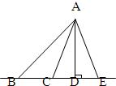

# Mathematics (Grade 3)

**ID**: 113db052
**难度**: medium_easy
**题型**: fill_in_the_blank

## 题目
如图，A点到直线BE的线段中，线段(    )长度最短，它的长度叫做点A到直线的(    )．

## 解答

**答案**: AD, 距离

1. Step1:根据点到直线距离的定义，从直线外一点到这条直线所画的垂直线段的长度，叫做这点到直线的距离
2. Step2:观察图形可知，A点到直线BE的线段中，AD是垂直线段，所以线段AD长度最短
3. Step3:因为AD是A点到直线BE的垂直线段，根据定义它的长度叫做点A到直线的距离

## 知识点

**知识点**:
  - 两点间线段最短与两点间的距离．

---
