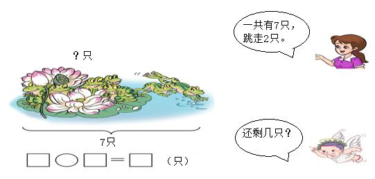

# Mathematics (Grade 3)

**ID**: 1685d878
**难度**: medium_easy
**题型**: fill_in_the_blank

## 题目
看图写算式。

## 解答

**答案**: 7-2=5

1. Step1:观察图片可知，图中总共有7只青蛙，这是青蛙的初始数量
2. Step2:看到图中提示跳走2只，这是减少的数量
3. Step3:求还剩下几只青蛙，就是用总数减去跳走的数量，所以用7 - 2来计算
4. Step4:计算7 - 2的结果为5，所以算式为7 - 2 = 5

## 知识点

**知识点**:
  - 小学数学;数与代数;应用题;常见的数学问题;图文问题

---
