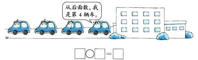

# Mathematics (Grade 3)

**ID**: 18a8ac37
**难度**: medium_easy
**题型**: fill_in_the_blank

## 题目
一共有几辆车？

## 解答

**答案**: 7

1. Step1:明确从后面数是第4辆车，这表明包括说话的这辆车在内后面有4辆车
2. Step2:观察图中说话车辆前面有3辆车
3. Step3:求车辆总数，需将前面的3辆车和后面的4辆车相加
4. Step4:计算3 + 4 = 7，得出一共有7辆车

## 知识点

**知识点**:
  - 小学数学;数与代数;应用题;简单应用题;整数简单应用题;图形与几何;位置与方向;位置

---
