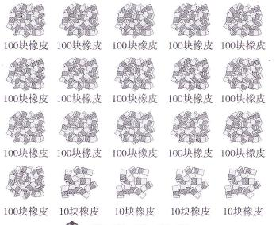

# Mathematics (Grade 3)

**ID**: 20ac49e0
**难度**: medium_easy
**题型**: fill_in_the_blank

## 题目
有多少块橡皮?( )块。

## 解答

**答案**: 1640

1. Step1:先数出整百块橡皮的堆数，有16堆，每堆100块，那么整百块橡皮的数量为16×100 = 1600块
2. Step2:再数出整十块橡皮的堆数，有4堆，每堆10块，那么整十块橡皮的数量为4×10 = 40块
3. Step3:将整百块橡皮数量和整十块橡皮数量相加，即1600 + 40 = 1640块

## 知识点

**知识点**:
  - 

---
