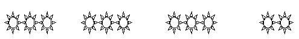

# Mathematics (Grade 3)

**ID**: 2571a20f
**难度**: medium_easy
**题型**: fill_in_the_blank

## 题目
看图列式并计算。

______________

## 解答

**答案**: 3×3+2=11

1. Step1:观察图片可知，前面三组每组有3个图案
2. Step2:根据乘法的意义，前面三组图案的总数为3×3
3. Step3:再观察到最后一组有2个图案
4. Step4:求所有图案的总数，需将前面三组的总数与最后一组的数量相加，即3×3+2
5. Step5:计算3×3+2的结果为11

## 知识点

**知识点**:
  - 小学数学;数与代数;应用题;常见的数学问题;图文问题

---
