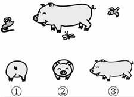

# Mathematics (Grade 3)

**ID**: 25d8d9ae
**难度**: medium_easy
**题型**: fill_in_the_blank

## 题目
小老鼠看到的是图（____），蜻蜓看到的是图（____），小鸟看到的是图（____）。

## 解答

**答案**: ②, ③, ①

1. Step1:确定小老鼠的位置，小老鼠在猪的侧面，从侧面看猪能看到猪的侧面轮廓，所以小老鼠看到的是图②
2. Step2:确定蜻蜓的位置，蜻蜓在猪的前方，从前方看猪能看到猪的正面，所以蜻蜓看到的是图③
3. Step3:确定小鸟的位置，小鸟在猪的上方，从上方看猪能看到猪的背部轮廓，所以小鸟看到的是图①

## 知识点

**知识点**:
  - 

---
