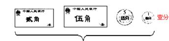

# Mathematics (Grade 3)

**ID**: 2ae970bf
**难度**: medium_easy
**题型**: fill_in_the_blank

## 题目
看图回答

（_______）角（______）分=（_____）分

## 解答

**答案**: 7, 6, 76

1. Step1:图中有一张贰角和一张伍角，贰角加伍角等于7角
2. Step2:图中有一枚伍分和一枚壹分，伍分加壹分等于6分
3. Step3:因为1角等于10分，7角换算成分是70分，再加上6分，总共是76分

## 知识点

**知识点**:
  - 小学数学;数与代数;常见的量;人民币单位及换算

---
