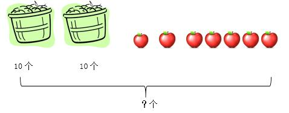

# Mathematics (Grade 3)

**ID**: 2fc71bad
**难度**: medium_easy
**题型**: fill_in_the_blank

## 题目
看图列式．

□○□=□（个）

## 解答

**答案**: 20, +, 7, 27

1. Step1:观察图片可知，左边两个桶里各有10个苹果，那么桶里苹果总数为10 + 10 = 20个
2. Step2:再看图片右边，有7个单独的苹果
3. Step3:要求苹果的总数，就是桶里的20个苹果加上右边的7个苹果
4. Step4:所以列式为20 + 7 = 27个
5. Step5:将算式中的数字和符号按顺序提取出来就是['20', '+', '7', '27']

## 知识点

**知识点**:
  - 

---
