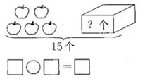

# Mathematics (Grade 3)

**ID**: 3713d91c
**难度**: medium_easy
**题型**: fill_in_the_blank

## 题目
看图列算式。

## 解答

**答案**: 15-5=10

1. Step1:观察图片可知，苹果总数是15个，左边能看到的苹果有5个，要求右边盒子里苹果的数量
2. Step2:根据减法的意义，已知总数和其中一部分，求另一部分用减法计算
3. Step3:用苹果的总数15减去左边看到的5个苹果，得到算式15 - 5
4. Step4:计算15 - 5的结果为10，所以完整算式是15 - 5 = 10

## 知识点

**知识点**:
  - 小学数学;数与代数;应用题;常见的数学问题;图文问题

---
