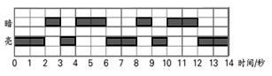

# Mathematics (Grade 3)

**ID**: 40aa7736
**难度**: medium_easy
**题型**: fill_in_the_blank

## 题目
海边灯塔上的一盏照明灯以固定的规律发出亮光（如图），第39秒照明灯是（_______）的。（填“亮”或“暗”）

## 解答

**答案**: 暗

1. Step1:观察图形可知，照明灯亮暗的规律是亮2秒、暗3秒、亮2秒、暗2秒，一个周期的时长为2 + 3 + 2 + 2 = 9秒。
2. Step2:用39除以一个周期的时长9秒，即39÷9 = 4余3。
3. Step3:这意味着经过了4个完整周期后，又过了3秒。
4. Step4:根据规律，前2秒是亮的，第3秒是暗的，所以第39秒照明灯是暗的。

## 知识点

**知识点**:
  - 小学数学;探索规律;简单间隔、周期规律

---
