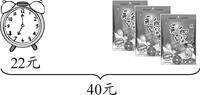

# Mathematics (Grade 3)

**ID**: 45591fa8
**难度**: medium_easy
**题型**: fill_in_the_blank

## 题目
一包豆浆多少元？

## 解答

**答案**: 6

1. Step1:已知闹钟价格是22元，闹钟和3包豆浆总价是40元，先计算出3包豆浆的总价，用40 - 22 = 18元
2. Step2:再根据3包豆浆总价是18元，计算出一包豆浆的价格，用18÷3 = 6元

## 知识点

**知识点**:
  - 小学数学;数与代数;应用题;常见的数学问题;图文问题;经济问题;复合应用题;整数四则复合应用题

---
