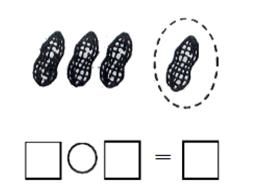

# Mathematics (Grade 3)

**ID**: 45deedb3
**难度**: medium_easy
**题型**: fill_in_the_blank

## 题目
看图列式

## 解答

**答案**: 4－1＝3

1. Step1:观察图片，发现一共有4颗花生，其中用虚线框圈起来了1颗花生
2. Step2:根据减法的意义，从总数4颗花生中去掉被圈起来的1颗花生，用减法计算
3. Step3:列出算式4 - 1，计算结果为3，即4－1＝3

## 知识点

**知识点**:
  - 小学数学;数与代数;应用题;常见的数学问题;图文问题

---
