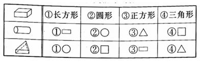

# Mathematics (Grade 3)

**ID**: 4b387a48
**难度**: medium_easy
**题型**: fill_in_the_blank

## 题目
有三块印泥，像下面这样印，能印出什么形状？

## 解答

**答案**: ①, ②, ④

1. Step1:观察第一个印泥，印出的形状对应①
2. Step2:观察第二个印泥，印出的形状对应②
3. Step3:观察第三个印泥，印出的形状对应④

## 知识点

**知识点**:
  - 

---
