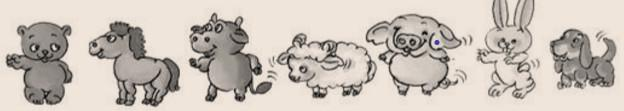

# Mathematics (Grade 3)

**ID**: 5083dc53
**难度**: medium_easy
**题型**: fill_in_the_blank

## 题目
数一数

（1）一共有（_____）个小动物
（2）从左数，小猪在第（_____）位
（3）从右数，小羊在第（_____）位

## 解答

**答案**: 7, 5, 4

1. Step1:从左到右依次数图中的小动物，可得一共有7个小动物
2. Step2:从左数，依次数到小猪，确定小猪在第5位
3. Step3:从右数，依次数到小羊，确定小羊在第4位

## 知识点

**知识点**:
  - 

---
