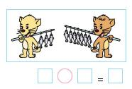

# Mathematics (Grade 3)

**ID**: 5c692358
**难度**: medium_easy
**题型**: fill_in_the_blank

## 题目
一共有几条鱼?

## 解答

**答案**: 10

1. Step1:观察图片可知，左边小猫钓了3条鱼，右边小猫钓了7条鱼
2. Step2:要求一共有几条鱼，就是把两边鱼的数量合起来，用加法计算
3. Step3:可列式为3 + 7 = 10或者7 + 3 = 10，所以一共有10条鱼

## 知识点

**知识点**:
  - 小学数学;数与代数;应用题;简单应用题;整数简单应用题

---
