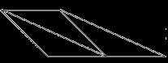

# Mathematics (Grade 3)

**ID**: 60bf1aac
**难度**: medium_easy
**题型**: fill_in_the_blank

## 题目
图中一共有（_____）组平行线．

## 解答

**答案**: 3

1. Step1:明确在同一平面内不相交的两条直线叫做平行线
2. Step2:观察图形，数出平行线的组数
3. Step3:得出图中一共有3组平行线

## 知识点

**知识点**:
  - 

---
