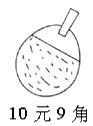

# Mathematics (Grade 3)

**ID**: 61577a1e
**难度**: medium_easy
**题型**: fill_in_the_blank

## 题目
填上适当的小数．
  ________元

## 解答

**答案**: 10.9

1. Step1:因为 1 角 = 0.1 元，9 角换算成元为 9×0.1 = 0.9 元
2. Step2:10 元保持不变，10 元与 0.9 元合起来是 10 + 0.9 = 10.9 元

## 知识点

**知识点**:
  - 小学数学;数与代数;常见的量;人民币单位及换算

---
