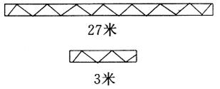

# Mathematics (Grade 3)

**ID**: 69528727
**难度**: medium_easy
**题型**: fill_in_the_blank

## 题目
长绳的长度是短绳的多少倍。

□○□＝□

## 解答

**答案**: 27, 3, 9

1. Step1:明确问题是求长绳长度27米是短绳长度3米的多少倍
2. Step2:根据倍数关系，用长绳长度除以短绳长度，即27÷3
3. Step3:计算27÷3的结果为9

## 知识点

**知识点**:
  - 小学数学;数与代数;数的运算

---
