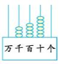

# Mathematics (Grade 3)

**ID**: 6c560d08
**难度**: medium_easy
**题型**: fill_in_the_blank

## 题目
写作:(     )  读作:(      )

## 解答

**答案**: 3460, 三千四百六十

1. Step1:观察计数器，千位上有3个珠子，表示3个千，即3000；百位上有4个珠子，表示4个百，即400；十位上有6个珠子，表示6个十，即60；个位上没有珠子，用0表示。
2. Step2:将各个数位上表示的数相加，3000 + 400 + 60 + 0 = 3460，所以写作3460。
3. Step3:根据整数的读法，从高位到低位，一级一级地读，每一级末尾的0都不读出来，其余数位连续几个0都只读一个零，3460读作三千四百六十。

## 知识点

**知识点**:
  - 

---
