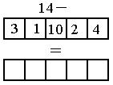

# Mathematics (Grade 3)

**ID**: 6d778c22
**难度**: medium_easy
**题型**: fill_in_the_blank

## 题目
在方框里填上正确的数． 

     。

## 解答

**答案**: 11, 13, 4, 12, 10

1. Step1:计算14 - 3 = 11
2. Step2:计算14 - 1 = 13
3. Step3:计算14 - 10 = 4
4. Step4:计算14 - 2 = 12
5. Step5:计算14 - 4 = 10

## 知识点

**知识点**:
  - 

---
