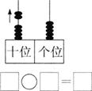

# Mathematics (Grade 3)

**ID**: 81cb0e96
**难度**: medium_easy
**题型**: fill_in_the_blank

## 题目
看图列式计算。                                 

## 解答

**答案**: 65-20=45

1. Step1:观察计数器，十位上原来有6个珠子，表示6个十即60，个位上有5个珠子，表示5个一即5，合起来原来的数是65。
2. Step2:看到十位上拿走2个珠子，拿走的是2个十即20。
3. Step3:求剩下的数，用原来的数65减去拿走的20，列式为65 - 20。
4. Step4:计算65 - 20的结果为45，所以得出65 - 20 = 45。

## 知识点

**知识点**:
  - 小学数学;数与代数;应用题;常见的数学问题;图文问题

---
