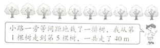

# Mathematics (Grade 3)

**ID**: 81f8189b
**难度**: medium_easy
**题型**: fill_in_the_blank

## 题目

（1）每相邻两棵树之间的距离是（______）m。
（2）从第1棵树到最后1棵树的距离是（______）m。

## 解答

**答案**: 10, 90

1. Step1:从第1棵树走到第5棵树，中间间隔数为5 - 1 = 4个。一共走了40m，所以每相邻两棵树之间的距离是40÷4 = 10m，得出第一空答案为10。
2. Step2:观察图片可知一共有10棵树，从第1棵树到最后1棵树中间间隔数为10 - 1 = 9个，又因为每相邻两棵树距离是10m，所以从第1棵树到最后1棵树的距离是9×10 = 90m，得出第二空答案为90。

## 知识点

**知识点**:
  - 小学数学;数与代数;应用题;常见的数学问题;植树问题

---
