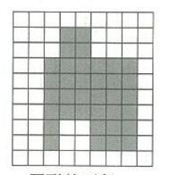

# Mathematics (Grade 3)

**ID**: 8b938836
**难度**: medium_easy
**题型**: fill_in_the_blank

## 题目

 图形的面积是（  ）cm²

## 解答

**答案**: 36

1. Step1:明确已知条件，每个小格面积是1cm²
2. Step2:通过数图形所占小格的数量来计算图形面积
3. Step3:数出图形共占36个小格
4. Step4:因为每个小格面积为1cm²，所以图形面积为36×1 = 36cm²

## 知识点

**知识点**:
  - 图形的运动（二）;平移

---
