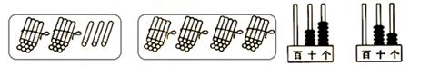

# Mathematics (Grade 3)

**ID**: 8bd07eb6
**难度**: medium_easy
**题型**: fill_in_the_blank

## 题目
看图写数。

（______）      （______）      （______） （______）

## 解答

**答案**: 23, 40, 46, 53

1. Step1:观察第一个图，左边两捆小棒，每捆10根，共20根，右边3根，合起来是23
2. Step2:观察第二个图，有四捆小棒，每捆10根，共40根
3. Step3:观察第三个计数器，十位上4个珠子表示40，个位上6个珠子表示6，合起来是46
4. Step4:观察第四个计数器，十位上5个珠子表示50，个位上3个珠子表示3，合起来是53

## 知识点

**知识点**:
  - 小学数学;数与代数;数的认识;整数的认识

---
