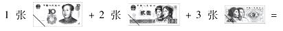

# Mathematics (Grade 3)

**ID**: 8c084292
**难度**: medium_easy
**题型**: fill_in_the_blank

## 题目
（_____）元（______）角

## 解答

**答案**: 14, 3

1. Step1:明确题目是要计算不同面值人民币的总和对应的元与角的数值
2. Step2:1张10元是10元，2张2元是2×2 = 4元，所以元的部分是10 + 4 = 14元
3. Step3:3张1角是3×1 = 3角
4. Step4:得出结果为14元3角，对应答案中第一个元素为14，第二个元素为3

## 知识点

**知识点**:
  - 小学数学;数与代数;常见的量;人民币单位及换算

---
