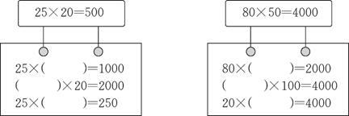

# Mathematics (Grade 3)

**ID**: 921c4619
**难度**: medium_easy
**题型**: fill_in_the_blank

## 题目
在(  )里填上合适的数。   

## 解答

**答案**: 40, 100, 10, 25, 40, 200

1. Step1:已知25×20 = 500，要使25×( ) = 1000，因为1000÷25 = 40，所以括号里应填40
2. Step2:要使( )×20 = 2000，因为2000÷20 = 100，所以括号里应填100
3. Step3:要使25×( ) = 250，因为250÷25 = 10，所以括号里应填10
4. Step4:已知80×50 = 4000，要使80×( ) = 2000，因为2000÷80 = 25，所以括号里应填25
5. Step5:要使( )×100 = 4000，因为4000÷100 = 40，所以括号里应填40
6. Step6:要使20×( ) = 4000，因为4000÷20 = 200，所以括号里应填200

## 知识点

**知识点**:
  - 

---
