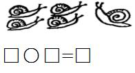

# Mathematics (Grade 3)

**ID**: 98a7ed77
**难度**: medium_easy
**题型**: fill_in_the_blank

## 题目
看图列式计算． 

## 解答

**答案**: 4+1=5

1. Step1:观察图片可知，左边有4只蜗牛，右边有1只蜗牛
2. Step2:求蜗牛的总数，需将左边和右边的蜗牛数量相加
3. Step3:所以列式为4 + 1 = 5

## 知识点

**知识点**:
  - 小学数学;数与代数;应用题;常见的数学问题;图文问题

---
