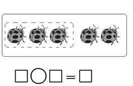

# Mathematics (Grade 3)

**ID**: b9b3a8e2
**难度**: medium_easy
**题型**: fill_in_the_blank

## 题目
我会看图列式计算。

## 解答

**答案**: 5-3=2

1. Step1:观察图片，发现图中一共有5只瓢虫
2. Step2:看到虚线框内有3只瓢虫，表示要去掉这3只
3. Step3:根据减法的意义，求剩下几只瓢虫，用总数5减去去掉的3只，列式为5 - 3
4. Step4:计算5 - 3的结果为2，所以得出5 - 3 = 2

## 知识点

**知识点**:
  - 小学数学;数与代数;应用题;常见的数学问题;图文问题

---
