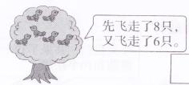

# Mathematics (Grade 3)

**ID**: bff9819a
**难度**: medium_easy
**题型**: fill_in_the_blank

## 题目
树上有20只小鸟,一共飞走了多少只?
□○□="□" （只）

## 解答

**答案**: 8+6=14

1. Step1:明确题目所求为一共飞走的小鸟数量
2. Step2:已知先飞走8只，又飞走6只
3. Step3:求总数需将两次飞走的数量相加，即8 + 6
4. Step4:计算得出8 + 6 = 14

## 知识点

**知识点**:
  - 小学数学;数与代数;应用题;简单应用题

---
